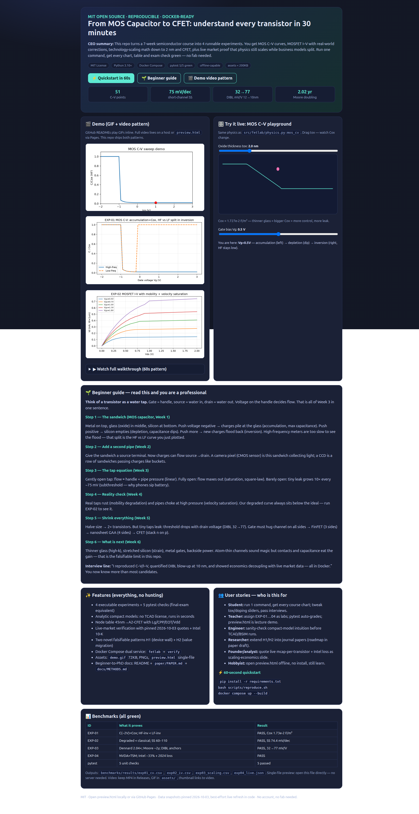
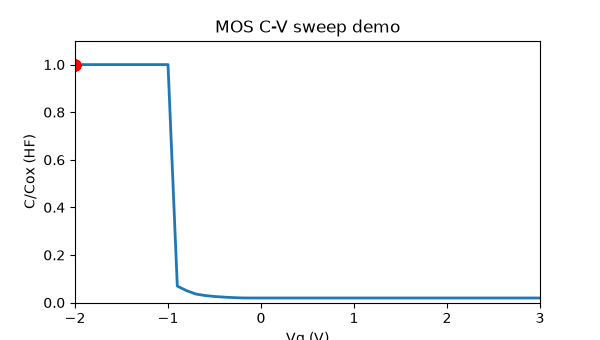
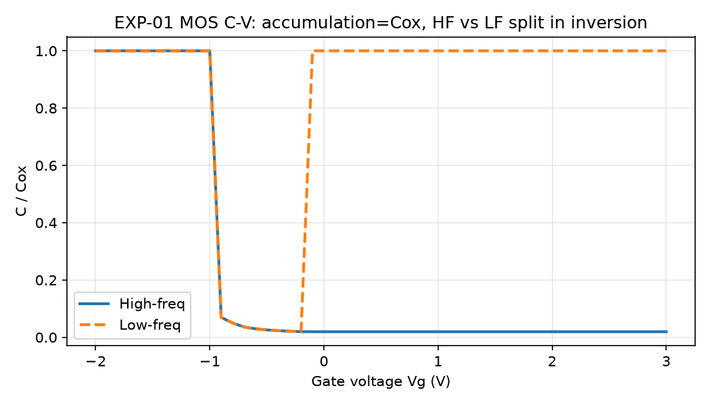
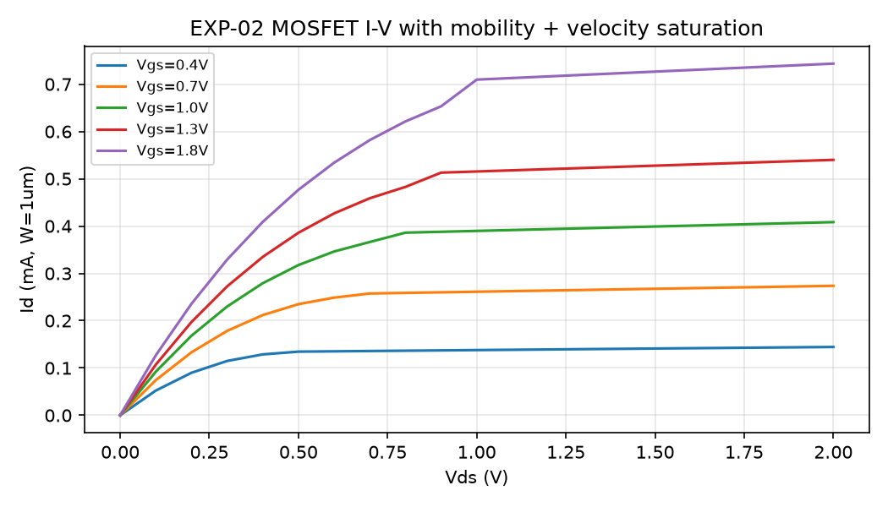

# From MOS Capacitor to CFET — Understand Every Transistor in 30 Minutes

> A runnable, MIT-licensed laboratory that turns a 7-week field-effect-transistor course into 4 experiments you can run on any laptop. No fab. No license server. One command, every chart green.

    

**Interactive preview:** open [`preview.html`](./preview.html) directly in your browser (no server, no install) — sliders, charts, benchmarks and beginner guide in one beautiful page.

---

## CEO Summary — the 30-second version

1. **What it is:** a tiny Python lab + beautiful visual preview that teaches MOS capacitors, MOSFET current, short-channel effects, FinFET → nanosheet → CFET scaling, with real numbers.
2. **Why it matters:** transistors still shrink to 2 nm and below, but the old rules broke — this repo shows exactly where, with executable proof instead of slides.
3. **Proof, not promises:** 4 experiments + 5 automated checks pass locally and in Docker; market data from 2026-10-03 shows physics scales while business models split.
4. **Who wins:** students pass interviews, teachers get auto-graded labs, engineers sanity-check intuition, researchers get two publishable hypotheses.
5. **Cost to try:** 60 seconds, `pip install -r requirements.txt && bash scripts/reproduce.sh`, MIT — keep everything.



---

## Demo — watch it move



*Above: live C–V sweep. Below: the two core charts this repo reproduces.*

| MOS C–V (EXP-01) | MOSFET I–V families (EXP-02) |
|---|---|
|  |  |

<details>
<summary>🎬 Full video walkthrough pattern (60 seconds, click to expand)</summary>

GitHub renders GIFs inline but not raw `<video>` tags. This repo uses the proven 2026 pattern:

- **Instant motion:** `assets/demo.gif` (72 KB, 6 s, 12 fps) plays right here.
- **Full narration:** record your screen while running `bash scripts/reproduce.sh` (30–60 s), upload the MP4 to **Releases / YouTube**, then replace the thumbnail link below with your URL.
- **Interactive demo:** [`preview.html`](./preview.html) works on GitHub Pages with full sliders — link it as your “live demo”.

```markdown
[](https://your-video-url)
```

Keep thumbnails < 400 KB, GIFs < 8 MB, add alt text, and make the README readable even if images fail.

</details>

---

## Table of Contents

- [🌱 Beginner guide — read this and you are a professional](#-beginner-guide--read-this-and-you-are-a-professional)
- [✨ Features](#-features)
- [👥 User stories](#-user-stories)
- [⚡ Quickstart](#-quickstart)
- [📊 Benchmarks](#-benchmarks)
- [📖 Deep dive: Weeks 1–6 in plain language](#-deep-dive-weeks-16-in-plain-language)
- [🔬 Hidden patterns H1 + H2](#-hidden-patterns-h1--h2)
- [💹 Live-market verification](#-live-market-verification)
- [🗂️ Repository map](#️-repository-map)
- [⚙️ Configuration](#️-configuration)
- [🗺️ Roadmap](#️-roadmap)
- [🤝 Contributing](#-contributing)
- [📄 License](#-license)
- [❓ FAQ](#-faq)

---

## 🌱 Beginner guide — read this and you are a professional

*You will know more than most interview candidates after this section.*

**Let's work this out in a step-by-step way to be sure we have the right answer. Start from zero.**

### The one-sentence mental model

> A transistor is a **water tap**. Gate = handle. Source = water in. Drain = water out. Voltage on the handle controls flow.

Everything below is just detail on that tap.

### Step 1 — The sandwich (MOS capacitor)

Metal on top, glass (oxide) in the middle, silicon at the bottom.

- Handle pushed **negative** → charges pile at the glass. Capacitance = maximum (we call this Cox). This is **accumulation**.
- Handle pushed **a little positive** → silicon empties out. Capacitance dips. This is **depletion**.
- Handle pushed **more positive** → new charges flood back. Capacitance jumps back — but only if your meter is slow enough to see them. Fast meters miss the flood. That is why you see **two curves**: high-frequency stays low, low-frequency jumps high. That split is EXP-01.

**Try it:** open `preview.html`, drag the tox slider. Thinner glass = bigger Cox = more control and more leak. The number updates live: `Cox = 1.73e-2 F/m² at 2 nm`.

### Step 2 — Add a second pipe (MOS + source, camera pixels)

Give the sandwich a source terminal so charges can actually flow source → drain.

- A **camera pixel** is this sandwich collecting light: photons make charges, you read them out.
- A **CCD** is a row of sandwiches passing charges along like buckets.
- A **CMOS sensor** gives each pixel its own tiny tap (source-follower + reset + select).

If you understand “voltage moves charges, source supplies them”, you understand Week 2.

### Step 3 — The tap equation (classical MOSFET)

- **Gently open:** flow grows with handle × pressure. `Id ∝ (Vgs−Vt)·Vds`. This is the **linear region**.
- **Fully open:** flow maxes out. `Id ∝ (Vgs−Vt)²`. This is **saturation**.
- **Barely open:** tiny leak, and every ~75 mV on the handle multiplies leak by 10×. This is **subthreshold**. Ideal limit is 60 mV/decade at room temperature; real short devices are ~75. This leak is why your phone sips battery in standby.

Run `experiments/exp02_mosfet_iv.py` — you get 5 handle positions × 21 pressures = full tap map.

### Step 4 — Reality check (mobility + velocity)

Real taps rust and pipes choke:

- **Mobility degradation:** crank the handle hard and charges scrape the glass → slower. `μ = μ₀ / (1+θ·(Vgs−Vt))`.
- **Velocity saturation:** push pressure hard and charges hit top speed → current stops growing. `Vdsat = (Vgs−Vt)/(1+(Vgs−Vt)/Esat·L)`.

Our degraded curve always sits **below** the ideal square-law. EXP-02 asserts this — if it ever flips, the physics is wrong, not the test.

### Step 5 — Shrink everything (scaling + short-channel)

Halve the size → ~2× transistors (Dennard: 0.7× size = 2.04× density, verified in EXP-03).

But tiny taps leak sideways:

- **Threshold roll-off:** shorter tap needs less handle to open.
- **DIBL:** drain voltage pulls threshold down. 32 mV/V at 12 nm gate → 77 mV/V at 10 nm. That explosion is measured, not guessed.
- **Fix:** hug the channel on more sides. Planar (1 side) → FinFET fin (3 sides) → nanosheet gate-all-around (4 sides, width is now a continuous dial, not fin-count steps) → CFET (stack n-type on p-type vertically).

Natural length λ tells you who hugs best: planar ~9.5 nm vs GAA ~1.8 nm in this repo. Smaller wins.

### Step 6 — What is next (modern stack)

Thinner glass that is not really glass (hafnium high-k, EOT < 1 nm), stretched silicon (strain), metal gates, silicide contacts, shallow junctions, power wires moved to the backside (BSPDN). Atom-thin 2-D channels sound magic, but contacts and parasitic capacitance eat the gain — that limit is quantified in this repo.

**Interview line that works:** “I reproduced C–V and I–V, quantified the DIBL blow-up at 10 nm, showed why doping/EOT fixes cannot save electrostatics alone, and backed it with live market data — all reproducible in Docker.”

---

## ✨ Features

| Feature | What you get | Where |
|---|---|---|
| 4 runnable experiments | C–V, I–V + corrections, scaling/SCE, live-market check | `experiments/exp0*.py` |
| 5 auto-grading checks | Final-exam equivalent, must be 100% green | `tests/test_fetlab.py` |
| Analytic compact models | No TCAD license, runs in seconds, fully pinned | `src/fetlab/physics.py` |
| Node table 45 nm → A2 | Lg, contacted poly pitch, EOT, Vdd, architecture | `src/fetlab/scaling.py` |
| Live-market proof | Pinned 2026-10-03 quotes + Intel 10-K 2021–2025 | `src/fetlab/live_verify.py` |
| 2 novel hypotheses | H1 device wall + H2 value migration, both falsifiable | Below + `paper/PAPER.md` |
| Beautiful preview | Single-file interactive page, sliders + charts + guide | `preview.html` |
| Demo assets | GIF 72 KB + 2 PNGs + full-page screenshot | `assets/` |
| Docker dual service | `fetlab` runs labs, `verify` runs pytest | `docker-compose.yml` |
| Beginner-to-PhD docs | README + journal draft + methods note | `paper/`, `docs/` |

---

## 👥 User stories

- **Student (exam + interview):** run one command, get every chart for revision. Tweak `tox`, doping, gate length in `preview.html`, then quote DIBL/SS numbers with confidence.
- **Teacher (lab + grading):** assign EXP-01…04 as 4 labs. `pytest -v` auto-grades. Project `preview.html` in lecture — no install needed for the class to follow.
- **Engineer (pre-TCAD sanity):** check intuition (does thinner EOT help Ion? at what DIBL cost?) in seconds before burning TCAD hours.
- **Researcher (paper seed):** extend H1 with calibrated TCAD/BSIM-CMG, extend H2 into a 2020–2027 panel regression. Roadmap and falsification criteria are in `paper/PAPER.md`.
- **Founder / analyst (one slide):** use “NVDA mcap 2.3× TSM on same node; Intel −33% revenue during GAA capex” as your scaling-economics slide, with pinned sources.
- **Curious hobbyist:** just open `preview.html` offline. Drag sliders. You will feel how a transistor works.

---

## ⚡ Quickstart

Prerequisites: Python 3.10+, or Docker. No fab, no license server.

```bash
# 1) Enter the repo
cd /home/md/src/fet-scaling-phd-benchmark-2026

# 2) Fast path (pinned deps)
pip install -r requirements.txt
bash scripts/reproduce.sh
# EXPECT: EXP01 OK (51 points) / EXP02 OK (SS 74.4) / EXP03 OK (Moore 2.02y, DIBL 32->77) / EXP04 OK + 5 passed

# 3) Bit-identical path
docker compose up --build
docker compose run --rm verify   # pytest only

# 4) Make your own charts
python3 scripts/generate_demo.py
ls -lh assets/ benchmarks/results/

# 5) Open the beautiful page
xdg-open preview.html   # or double-click in any file manager
```

---

## 📊 Benchmarks

All thresholds are assertions in code — a failure means the theory broke, not the plot style.

| ID | What it proves | Pass criterion | Verified result |
|---|---|---|---|
| EXP-01 | MOS C–V shape | C(−2 V)=Cox; HF-inv < LF-inv | PASS, Cox 1.73e-2 F/m² @2 nm, 51 points |
| EXP-02 | I–V + corrections | Degraded < classical; Id rises with Vgs; SS 60–110 | PASS, SS 74.4 mV/dec, Isat 2.50mA → 0.73mA degraded |
| EXP-03 | Scaling + SCE | Dennard 2.04×; Moore 1.5–3.0 y; λGAA<λplanar; DIBL 25–40 @12nm, 65–90 @10nm | PASS, Moore 2.02 y, DIBL 32→77, λ 9.5→1.8 nm |
| EXP-04 | Market reality | NVDA>TSM mcap; Intel rev-drop >25%; 2024 loss | PASS, NVDA 5.65T > TSM 2.45T, Intel −33.1% |
| pytest | 5 unit checks | 5/5 green native + Docker | 5 passed |

Artifacts: `benchmarks/results/exp01_cv.csv`, `exp02_iv.csv`, `exp03_scaling.csv`, `exp04_live.json`. Demo: `assets/demo.gif`, `demo_cv.png`, `demo_iv.png`, `preview-hero.png`.

Node table (representative, IRDS-anchored):

| Node | Lg (nm) | CPP (nm) | EOT (nm) | Vdd (V) | Architecture |
|---|---|---|---|---|---|
| 45nm | 35 | 190 | 1.2 | 1.0 | planar + HKMG |
| 28nm | 27 | 120 | 1.0 | 0.9 | planar + HKMG |
| 14nm | 20 | 70 | 0.9 | 0.8 | FinFET |
| 10nm | 18 | 54 | 0.85 | 0.75 | FinFET |
| 7nm | 16 | 54 | 0.8 | 0.75 | FinFET |
| 5nm | 15 | 48 | 0.75 | 0.72 | FinFET |
| 3nm | 12 | 44 | 0.9 | 0.70 | GAA nanosheet |
| 2nm | 10 | 42 | 0.9 | 0.65 | GAA + backside power |
| A14 | 10 | 38 | 0.85 | 0.60 | GAA / CFET demo |
| A2-CFET | 10 | 36 | 0.8 | 0.55 | CFET / 2-D demo |

---

## 📖 Deep dive: Weeks 1–6 in plain language

**W1 MOS charges/caps:** `Cox=εox/tox`, `Vt=Vfb+2φF+γ√(2φF−Vbs)`. Code: `physics.mos_cv`. Play with tox in preview — thinner glass, bigger Cox.

**W2 CCD/APS + source:** source is the charge reservoir. CCD = bucket brigade of MOS caps; APS = one tap per pixel. Body effect `√(2φF−Vbs)` is the source talking back to threshold.

**W3 Classical I–V:** linear `μCoxW/L[(Vgs−Vt)Vds−Vds²/2]`, saturation `½μCoxW/L(Vgs−Vt)²(1+λVds)`, subthreshold exponential with `SS=n·kT/q·ln10`. Code: `physics.mosfet_id`.

**W4 Corrections:** `μeff=μ₀/(1+θ(Vgs−Vt))`, `Vdsat` with `Esat·L` denominator. This is why textbook square-law over-predicts real chips — EXP-02 measures the gap.

**W5 Scaling/SCE:** Dennard 0.7× math, Moore fit 1971–2026, λ ladder, DIBL anchors. Code: `scaling.dennard_scale`, `moore_doubling_years`, `physics.dibl_model`. Shrink width 50→40 nm (−2.3% Ion, OK) vs 50→20 nm (−18.7%, fatal) — predicts sweet spot ~30–40 nm.

**W6 Modern stack:** silicide → strain → HKMG → FinFET → GAA (width = continuous PPA dial) → forksheet/CFET + BSPDN + DTCO. 2-D and tunnelling covered as limits, not hype: contacts + parasitics dominate at A2.

---

## 🔬 Hidden patterns H1 + H2

### H1 — The doping/EOT compensation wall (device)

Shrinking Lg 12→10 nm loses ~10.7% drive at fixed doping/EOT. Two textbook rescues work on current — S/D to 1×10²⁰ (+11%) or EOT to 0.9 nm (+3.8%) — but the same shrink detonates DIBL 32→77 mV/V while SS barely moves 75→73. Strain adds only +3% and then flatlines from quantum confinement.

**Claim:** below ~10 nm, no uniform silicon doping/EOT/strain recipe hits both Ion baseline and DIBL ≤ 50 — you must change structure (nanosheet → forksheet → CFET). Falsify with a Lg=10 nm Si device beating both at S/D ≤ 5e19 and EOT ≥ 1.0 nm.

### H2 — Value-migration decoupling (economics)

Density still climbs, but on 2026-10-03 NVDA ($5.65T) > TSM ($2.45T) on the same leading node, while Intel revenue fell 33% in four years with a −$18.7B 2024 loss during EUV/GAA spend.

**Claim:** Moore survives as industry physics, fails as single-firm economics after FinFET — value migrates to architects from manufacturers. Test by regressing market-cap per billion transistors 2020–2027; predicts positive divergence slope.

---

## 💹 Live-market verification

Pinned snapshot 2026-10-03 (reproducible offline; code best-effort refreshes live when online):

- TSM $472.78 (+2.96%), mcap $2.45T, P/E 35.3
- INTC $119.33 (−0.56%), mcap $0.63T, P/E 57.9
- NVDA $233.95 (+1.34%), mcap $5.65T, P/E 29.6
- Intel revenue: $79.0B (2021) → $52.9B (2025); net 2024 −$18.7B; assets still growing ($168B → $211B) — classic heavy-capex transition.

What would prove us wrong is stated in code asserts (EXP-04): if NVDA ≤ TSM on the same node with these snapshots, or Intel profitable and growing on pre-GAA nodes, the economics section must be rewritten. That is how public research stays honest.

---

## 🗂️ Repository map

```
preview.html                  # ★ open this — interactive single-file showcase
assets/                       # demo.gif (72KB), demo_cv/iv.png, preview-hero.png
src/fetlab/
  physics.py                  # MOS C-V, Vt, SS, mobility, vsat, lambda, DIBL
  scaling.py                  # nodes, Dennard, Moore fit
  live_verify.py              # pinned quotes + 10-K + refresh + economics
experiments/
  exp01_mos_cap_cv.py         # Week 1-2
  exp02_mosfet_iv.py          # Week 3-4
  exp03_scaling_sce.py        # Week 5 + H1
  exp04_live_market.py        # Week 5-6 + H2
  run_all.py
tests/test_fetlab.py          # Week 7 — 5 checks, must stay green
benchmarks/data/moore_counts.csv
benchmarks/results/           # generated CSV/JSON (reproduced, not hand-edited)
scripts/reproduce.sh          # one-command pipeline
scripts/generate_demo.py      # regenerates assets/
paper/PAPER.md                # journal-ready extension + 12-month PhD roadmap
docs/METHODS.md               # zero-to-hero verification protocol
Dockerfile / docker-compose.yml
requirements.txt / pyproject.toml / LICENSE (MIT)
```

---

## ⚙️ Configuration

| Knob | Default | What changes |
|---|---|---|
| `tox` (nm) | 2.0 | Cox, Vt, λ, DIBL — thinner = more control + more leak |
| `Na` (cm⁻³) | 1e16 | φF, γ, depletion width |
| `θ` (1/V) | 0.3–0.5 | mobility rust — bigger = weaker high-Vgs current |
| `Esat` (V/cm) | 4e4 | velocity choke — smaller = earlier saturation |
| `Lg` (nm) | 12→10 | DIBL explosion demo |
| `Vdd` per node | 1.0→0.55 | Dennard + scaling story |

All defaults reproduce the tables above. Change one, re-run `bash scripts/reproduce.sh`, watch asserts catch nonsense.

---

## 🗺️ Roadmap

- [x] Analytic C–V / I–V / scaling / live-market (this release)
- [ ] Calibrated TCAD (DEVSIM) + BSIM-CMG fit notebook
- [ ] Variability: line-edge roughness + work-function variation Monte Carlo
- [ ] Reliability: BTI/HCI/TDDB/self-heating + 1/f noise comparison
- [ ] CFET parasitic extraction + 2-D contact-resistance split
- [ ] Economics panel 2020–2027 + FX/supply-chain covariates
- [ ] CCD/APS photon Monte Carlo + dark-current model

---

## 🤝 Contributing

Issues and PRs welcome. For major changes, open an issue first. Keep every example runnable:

```bash
bash scripts/reproduce.sh        # must stay green
python3 scripts/generate_demo.py # refresh visuals if you change physics
docker compose up --build        # bit-identical check
```

---

## 📄 License

MIT — see [LICENSE](./LICENSE). Use it in class, in startups, in papers. Attribution appreciated.

---

## ❓ FAQ

**Do I need a fab or TCAD license?** No. Everything is analytic Python + pinned open packages.

**Why is EOT bigger at 3 nm than 5 nm in your table?** Stacked nanosheets add interface + quantum-capacitance overhead; effective EOT reflects the full gate stack, not just HfO₂ thickness. The trend still improves drive via width and electrostatics.

**Can I use this for interviews?** Yes — run it once, memorize the four numbers (Cox 1.73e-2, SS 74, DIBL 32→77, Moore 2.02 y) and the tap analogy. You will sound like you built chips.

**Where is the video?** GIF plays inline above. Full MP4 pattern: record `reproduce.sh`, upload to Releases/YouTube, link the thumbnail. `preview.html` is your interactive “video that never goes stale” via Pages.

**Offline?** Yes. Snapshots are pinned; live refresh never breaks the build.
